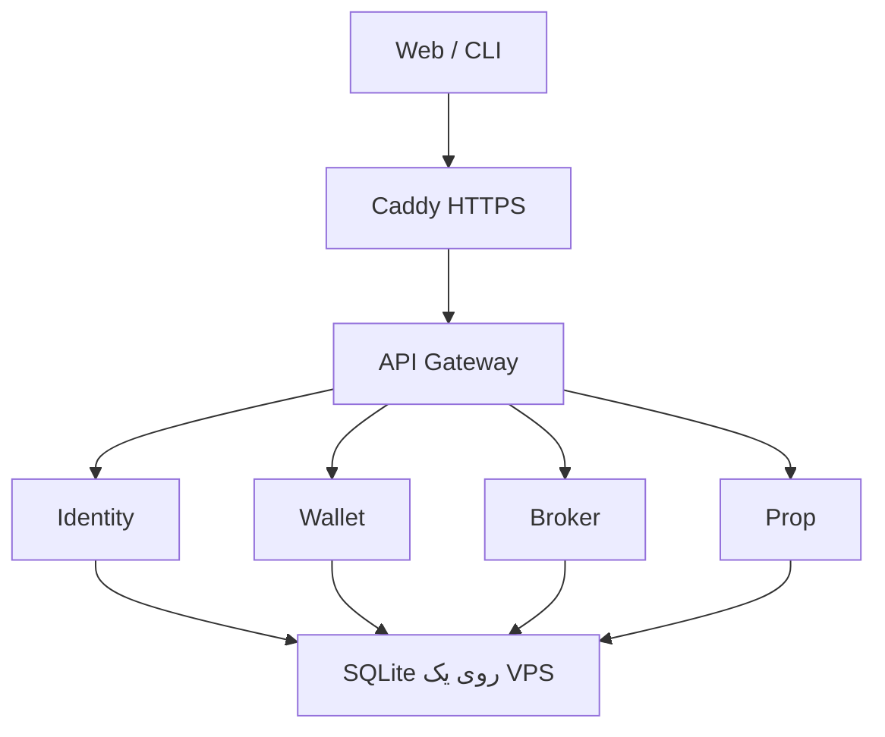

# معماری نسخه 0.1.0

مبنای ساختار، monorepo و سرویس‌های قابل اجرای مستقل در پروژه مرجع است. این پروژه از ابتدا پیاده شده و clone یا کپی کامل کد مرجع نیست.

## اجزا

| جزء | پورت داخلی | مسئولیت |
|---|---:|---|
| Gateway | 8080 | Web، هدایت API و security headers |
| Identity | 8101 | ثبت‌نام، login/logout و اطلاعات کاربر |
| Wallet | 8102 | درخواست/تأیید اعتبار، ledger، audit و کنترل سناریوی ادمین |
| Broker | 8103 | حساب، انتقال، سفارش و position شبیه‌سازی‌شده |
| Prop | 8104 | پلن، خرید و ارزیابی |
| Caddy | 80/443 | HTTPS و ورودی عمومی |

هر role با `python -m ako_fx.server --service ROLE` مستقل اجرا می‌شود. Gateway از HTTP داخلی استفاده می‌کند. برای توسعه، role پیش‌فرض all همه مسیرها را در یک process ارائه می‌کند. هیچ dependency حلقوی HTTP بین domain serviceها وجود ندارد.

## مرز استقلال

Module، process و سطح API مستقل‌اند؛ داده در یک فایل SQLite مشترک روی local volume نگهداری می‌شود. این انتخاب، پرداخت هزینه Prop و صدور حساب یا انتقال Wallet/Broker را در یک تراکنش اتمی نگه می‌دارد. مالکیت منطقی داده وجود دارد اما کاربران DB و schemaهای مجزا وجود ندارند. این نسخه برای چند host، NFS یا high availability طراحی نشده است.

برای استقلال کامل داده در نسخه بعد، Ledger باید سرویس مستقل با API رزرو/commit/cancel شود؛ outbox، recovery، reconciliation و عملیات جبرانی پیش‌نیاز حذف تراکنش مشترک هستند. تغییر به PostgreSQL به‌تنهایی این مسئله را حل نمی‌کند.

## دفترکل

هر transfer دقیقاً دو entry با مجموع صفر تولید می‌کند. demo:issuer تنها حساب مجاز با بدهی منفی است و پشتوانه صدور اعتبار آزمایشی است. balances یک cache تراکنشی از entries است. triggerها UPDATE/DELETE entries را رد می‌کنند؛ مالک host/DB همچنان توان تغییر schema دارد، بنابراین ledger در برابر ادمین سیستم tamper-proof نیست.

BEGIN IMMEDIATE، foreign keys، WAL و busy timeout از هم‌زمانی تراکنش‌ها محافظت می‌کنند. Idempotency-Key داخل همان تراکنش ذخیره می‌شود؛ کلید مشترک با payload متفاوت conflict می‌دهد. تأیید دوباره یک funding request با کلید جدید نیز conflict می‌دهد.

## مدل معاملات مصنوعی

قیمت پایه EURUSD=1.10، GBPUSD=1.25 و USDJPY=150 است؛ تمام آن‌ها صرفاً واحد قیمت مصنوعی با scale=10000 هستند. این مدل تبدیل ارز quote به DEMO-USD ندارد و شبیه‌ساز معتبر اقتصاد Forex نیست.

ادمین در هر گام ±۵٪ قیمت پایه اعمال می‌کند؛ قیمت در بازه ۵۰٪ تا ۱۵۰٪ محدود است. reset فقط قیمت را به پایه می‌برد؛ ledger یا معاملات را پاک نمی‌کند. سناریو بازار مشترک همه کاربران را تغییر می‌دهد.

رزرو هر position برابر حداکثر ارزش مصنوعی آن در سقف بازه است؛ این رزرو، زیان بدترین تغییر مجاز برای long و short را پوشش می‌دهد. `PnL cents = floor(signed price difference × quantity / 100)`. Spread، leverage، commission، order book، slippage، pending order و market feed در این نسخه وجود ندارد.

Prop پس از پرداخت هزینه، سرمایه مستقل دریافت می‌کند. سرمایه Prop به Wallet انتقال نمی‌یابد. زیان کل ۱۰٪ از سرمایه اولیه، شامل PnL باز، حساب را failed می‌کند و positionها اتمی بسته می‌شوند. سود ۱۰٪ فقط با positionهای بسته موجب passed می‌شود. passed/failed نهایی‌اند. daily drawdown، payout و مراحل چندگانه در این نسخه تعریف نشده‌اند.

## هویت و اجرا

PBKDF2-SHA256 با salt تصادفی و 260000 دور؛ session token تصادفی است و فقط hash آن ذخیره می‌شود. Session هشت ساعت اعتبار دارد. Web token را فقط در حافظه نگه می‌دارد؛ refresh مرورگر نیازمند ورود مجدد است. CLI از Bearer token استفاده می‌کند. Admin فقط با فرمان تعاملی محلی ساخته می‌شود.

Application server از Python stdlib استفاده می‌کند؛ reverse proxy برای TLS لازم است. محدودیت body و timeout و throttling ورود بر مبنای email وجود دارد. Rate limit مبتنی بر IP، MFA، بازیابی رمز، تأیید ایمیل و audit خارجی برای استقرار عمومی گسترده باید اضافه شوند. این نسخه ادعای Production acceptance ندارد.
